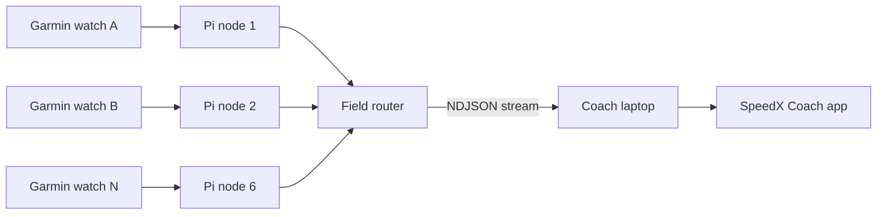

# 2 · System Architecture (Pi + Garmin)

[← Overview](01-overview.md) · [Wiki home](README.md)

---

## Components

| Component | Count | Responsibility |
|---|---:|---|
| Garmin watches | Any | Emit athlete running telemetry |
| Pi edge nodes | 4-6 | Collect nearby watch data, normalize packets, tag athlete/watch IDs |
| Field router | 1 | Aggregates edge-node traffic and forwards to laptop |
| Coach laptop app | 1 | Live dashboard, roster mapping, effort/stats view, recording/export |

## End-to-end data path



## Packet contract (router -> app)

The app expects newline-delimited JSON where each line is one sample. Recommended
minimum fields:

```json
{"t":"garmin","id":12,"team":1,"heart_rate":162,"distance_m":1840,"run_cadence":178}
```

Supported fields include:

- identity/tagging: `id`, `team`, `watch_id`, `device_id`, `athlete_id`
- core metrics: `heart_rate`, `pace_sec_per_mile`, `distance_m`, `speed_mps`,
  `run_cadence`, `stride_length_cm`
- effort: `effort_pct` (or compatible field names)
- optional GPS and advanced metrics when available

## Reliability expectations

1. Each Pi node buffers short outages and retries router publish.
2. Router stream is line-delimited JSON so the coach app can recover from partial
   lines cleanly.
3. Athlete IDs must stay stable through a session for roster mapping.

## Compatibility

The coach app still accepts legacy `{"t":"athlete", ...}` packets during
migration, so old and new emitters can coexist temporarily.
