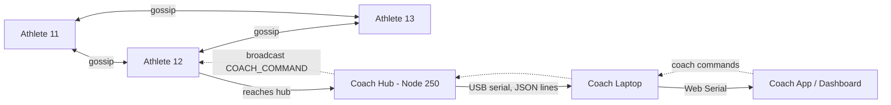
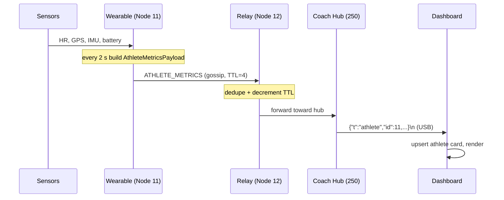

# 2 · System Architecture

[← Overview](01-overview.md) · [Wiki home](README.md) · Next: [Mesh Protocol →](03-mesh-protocol.md)

---

## Node roles

There are exactly two roles in production (plus three optional demo nodes kept
from the original ESP-NOW framework).

| Role | Node ID | Source | Job |
|------|---------|--------|-----|
| **Athlete wearable** | 11, 12, 13, … (unique) | [`../src/athlete_wearable/main.cpp`](../src/athlete_wearable/main.cpp) | Read sensors, gossip own metrics toward the hub, relay others' frames, obey coach commands |
| **Coach hub** | 250 (`COACH_HUB_NODE_ID`) | [`../src/coach_hub/main.cpp`](../src/coach_hub/main.cpp) | Collect all metrics, stream JSON over USB, beacon for discovery, broadcast coach commands |
| *Demo: sender/receiver/mesh* | 1 / 2 / 3 | `../src/node_*` | Original framework examples for bring-up testing |

`255` is the broadcast ID; `250` is reserved for the hub. Athletes take anything
else.

## The big picture



## Data flow (one metric sample)



## Three layers

1. **Shared library** (`../include/`) — frame format, send/receive helpers, peer
   registry, sensor abstraction. Header-only; every node links the same code.
2. **Node firmware** (`../src/`) — each role is a thin `main.cpp` that wires the
   library together with role-specific behavior.
3. **Host client** — reads the hub's USB JSON stream and renders the team. Two
   interchangeable options:
   - **SpeedX Coach desktop app** (Electron, separate repo
     [`speedx-coach-app`](https://github.com/olam-source/speedx-coach-app)) —
     adds athlete **roster management** (node id → name + team, saved to disk).
   - **Browser dashboard** (`../dashboard/coach_dashboard.html`) — a single HTML
     file, no install, athletes shown by node id.

```
include/   espnow_config.h · espnow_utils.h · peer_manager.h · athlete_sensors.h
src/       athlete_wearable/ · coach_hub/ · node_sender|receiver|mesh/
dashboard/ coach_dashboard.html
```

Details of each file are in [Firmware & Code Map](04-firmware-and-code-map.md).

## Key design decisions

| Decision | Why |
|----------|-----|
| **ESP-NOW, not Wi-Fi/BLE** | Connectionless, no router, low latency, ~200 m line-of-sight, built into every ESP32 |
| **Gossip flooding, not routing tables** | Zero configuration; survives nodes joining/leaving; no single point of failure |
| **Hub is a pure sink** | The coach laptop does the heavy UI; the hub just relays + prints, keeping it dumb and reliable |
| **Line-delimited JSON over USB** | Trivially parseable by the browser, Python, a logger, Grafana — anything |
| **Header-only shared lib** | One copy of the protocol; every node provably speaks the same format (enforced by `static_assert`) |
| **Build-flag sensor backend** | Same firmware runs simulated (no hardware) or real (with `-DUSE_REAL_SENSORS`) |
