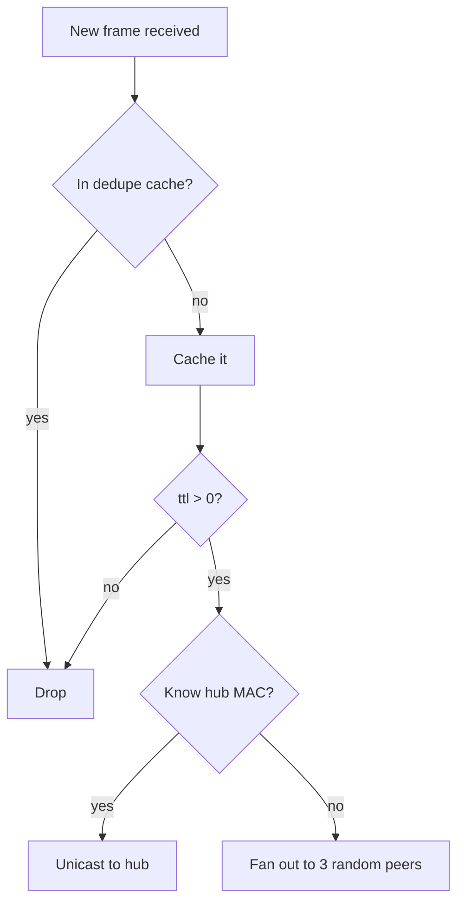

# 3 · Mesh Protocol

[← Architecture](02-architecture.md) · [Wiki home](README.md) · Next: [Firmware & Code Map →](04-firmware-and-code-map.md)

---

Defined in [`../include/espnow_config.h`](../include/espnow_config.h) and
implemented in [`../include/espnow_utils.h`](../include/espnow_utils.h).

## The frame

Everything travels in one packed struct capped at a single ESP-NOW v1 frame
(250 bytes): a 14-byte header + up to 236 bytes of payload.

```cpp
struct ESPNowMessage {
    MessageType type;      // what this frame is
    uint8_t sender_id;     // originating node
    uint8_t receiver_id;   // 250 = hub, 255 = broadcast, else a node id
    uint8_t sequence;      // per-sender counter (for dedupe + ACK)
    uint32_t timestamp;    // sender millis()
    uint8_t rssi;          // link quality (stamped on receive)
    uint16_t data_length;  // actual payload bytes (variable-length send)
    uint8_t ttl;           // hop budget — decremented on each forward
    uint8_t hop_count;     // hops travelled so far
    uint8_t flags;         // ACK_REQUESTED | FORWARDED | GOSSIP | URGENT
    uint8_t payload[236];  // typed payload (see below)
};
```

`static_assert`s guarantee the header is 14 bytes and the whole struct is exactly
250 — if anyone reorders a field and breaks the wire format, the build fails.

### Message types

| Type | # | Meaning |
|------|---|---------|
| `PING` / `PONG` | 0 / 1 | Discovery handshake |
| `DATA` / `ACK` | 2 / 4 | Generic payload + acknowledgement |
| `CONFIG` / `ERROR` | 3 / 5 | Reserved |
| `MESH_BEACON` | 6 | "I'm here, I have N peers" — periodic discovery |
| `MESH_DATA` | 7 | Forwarded generic payload |
| `ATHLETE_METRICS` | 8 | A wearable's vitals sample → hub |
| `ATHLETE_EVENT` | 9 | Reserved for discrete events |
| `COACH_COMMAND` | 10 | Hub → all athletes (start/stop/lap/…) |

### Typed payloads

- **`AthleteMetricsPayload`** — HR, pace, splits, distance, cadence, dynamics,
  battery, flags. ~40 bytes, fits comfortably in one frame.
- **`CoachCommandPayload`** — command id, target athlete (or `0xFF` = all),
  param, issue time.

## Gossip: how data reaches the hub without routing

A wearable doesn't know a route to the hub. It **floods intelligently**:

1. Tag the frame `GOSSIP`, set `ttl = 4`.
2. **Known hub?** If a beacon taught us the hub's MAC, unicast straight to it.
3. **Otherwise** fan out to up to `GOSSIP_FANOUT = 3` random peers (or broadcast
   if we have none).
4. Each receiver checks a **dedupe cache** (`GOSSIP_CACHE_SIZE = 32`, keyed by
   sender+sequence+type). Seen it? Drop it. New? Decrement `ttl`, increment
   `hop_count`, re-gossip.
5. `ttl` hits 0 → the frame dies. This kills loops and bounds flooding.



Net effect: a sample ripples across the team and reliably reaches the hub, with
no routing tables, no configuration, and graceful behavior when nodes come and
go. Relevant constants live at the top of `espnow_config.h`
(`ESPNOW_DEFAULT_TTL`, `GOSSIP_FANOUT`, `GOSSIP_CACHE_SIZE`,
`ATHLETE_METRIC_INTERVAL_MS`).

## Discovery

- The hub broadcasts a `MESH_BEACON` every few seconds.
- Any node that hears a frame registers the sender's MAC + id in its
  [`PeerManager`](../include/peer_manager.h).
- Once an athlete has heard the hub (directly or via a relayed beacon), it can
  unicast — otherwise it keeps gossiping. Peers time out after 30 s of silence.

## Coach commands (downstream)

The hub broadcasts a `COACH_COMMAND` with the `GOSSIP` flag; athletes apply it if
it targets them (or all) and **re-flood it** so it reaches the whole team even
multiple hops out. Supported: `START_SESSION`, `STOP_SESSION`, `MARK_LAP`,
`RESET_BEST`, `IDENTIFY`. See how they're handled in
[Firmware & Code Map](04-firmware-and-code-map.md).

## Reliability notes

- **ACKs** are best-effort: `ATHLETE_METRICS` requests an ACK so a wearable can
  prefer a working hub route, but delivery doesn't block on it.
- **Duplicate suppression** is per-node and bounded (ring buffer), so memory is
  constant regardless of team size.
- **Channel** must match across all nodes (`ESPNOW_CHANNEL = 1`).
